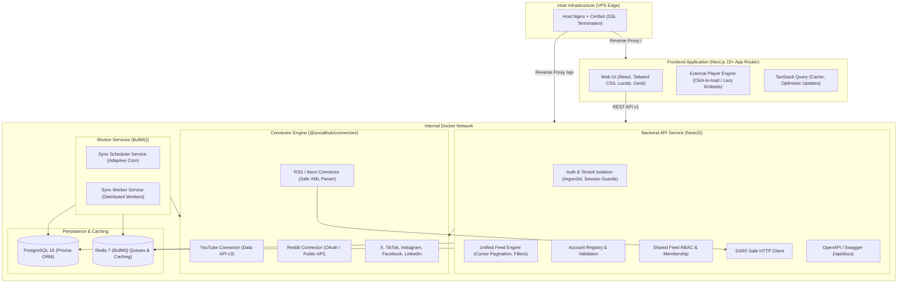

# SocialHub System Architecture

## 1. Executive Summary & Principles

**SocialHub** is a production-grade, self-hosted, multi-user social media aggregation platform. It enables individuals and teams to follow creators, channels, publications, and communities across platforms (YouTube, Reddit, RSS, X, TikTok, Instagram, Facebook, LinkedIn) within a unified, distraction-free editorial interface.

### Core Architecture Principles

1. **Content-First, Zero Video Hosting:**
   SocialHub strictly stores normalized post metadata and authorized media references (thumbnails, embed URLs). Under no circumstances are external video binaries downloaded, re-encoded, or hosted on the application servers. All video playback occurs via validated, sandboxed official iframe embeds or external links.
2. **Platform-Independent Normalized Domain:**
   Feed generation, ranking, filtering, bookmarking, and discovery interact exclusively with a normalized domain model (`NormalizedPost`, `ConnectedAccount`). Platform-specific API quirks, schemas, authentication mechanisms, and rate limits are fully encapsulated in individual connector modules.
3. **Strict Multi-Tenant Isolation:**
   Multi-tenancy is enforced at the database query layer and backend API authorization guards. User credentials, private feeds, bookmarks, and viewing histories are partitioned by user ID and never leak across tenant boundaries or into public feeds.
4. **Resilient, Deterministic Sync Agent:**
   Feed synchronization is decoupled from the web server using Redis and BullMQ. Sync jobs are deterministic, rate-limit aware, idempotent (stable composite keys `platform + externalId`), and resilient to transient network or provider failures with jittered exponential backoff.
5. **Security by Default:**
   Robust Argon2id session hashing, HttpOnly/SameSite cookies, CSRF protection, strict SSRF guards on URL previewing and RSS fetching (blocking local/private/cloud-metadata IP ranges), iframe sandboxing with strict Content Security Policy (CSP), and symmetric AES-256-GCM encryption for stored provider credentials.

---

## 2. System Architecture Diagram



---

## 3. Monorepo Package Layout

```
socialhub/
├── apps/
│   ├── web/                    # Next.js App Router frontend
│   └── api/                    # NestJS REST API server (Swagger, Auth, Feed, Accounts)
├── workers/
│   └── sync-worker/            # BullMQ worker process executing feed sync tasks
├── packages/
│   ├── database/               # Prisma schema, migrations, client singleton, seed scripts
│   ├── connectors/             # Connector interface, registry, and platform implementations
│   ├── shared/                 # Shared TypeScript DTOs, Zod schemas, types, constants
│   └── config/                 # Shared ESLint, Prettier, and TypeScript configs
├── infrastructure/
│   ├── docker/                 # Production Dockerfiles for web, api, and sync-worker
│   └── scripts/                # Database backup, restore, and maintenance scripts
├── docs/                       # Complete architectural and operational documentation
├── docker-compose.yml          # Local and base development composition
├── docker-compose.prod.yml     # Production overrides (isolated networks, logging, non-root)
├── pnpm-workspace.yaml         # Monorepo workspace configuration
├── Makefile                    # Operational tasks (dev, build, up, down, test, backup, restore)
├── .env.example                # Canonical environment variable specification
└── README.md                   # Project overview, quickstart, and operational guide
```

---

## 4. Normalized Data Model & Pipeline

All platforms transform upstream raw payloads into the standard `NormalizedPost` model:

```ts
export type Platform =
  | "YOUTUBE"
  | "REDDIT"
  | "RSS"
  | "X"
  | "TIKTOK"
  | "INSTAGRAM"
  | "FACEBOOK"
  | "LINKEDIN";

export type PostType =
  "TEXT" | "IMAGE" | "GALLERY" | "VIDEO" | "LINK" | "ARTICLE";

export interface NormalizedPost {
  externalId: string;
  platform: Platform;
  accountId: string;
  type: PostType;
  title?: string;
  text?: string;
  caption?: string;
  originalUrl: string;
  embedUrl?: string;
  thumbnailUrl?: string;
  publishedAt: Date;
  externalAuthor: {
    username: string;
    displayName?: string;
    profileImage?: string;
  };
  media: {
    type: "IMAGE" | "VIDEO" | "AUDIO" | "THUMBNAIL";
    url?: string;
    embedUrl?: string;
    width?: number;
    height?: number;
  }[];
  engagement?: {
    likes?: number;
    comments?: number;
    shares?: number;
    views?: number;
  };
  rawMetadata?: Record<string, unknown>;
}
```

### Ingestion & Deduplication Flow

1. **Source Polling:** Scheduler triggers a sync job on BullMQ for `ConnectedAccount(id)`.
2. **Lock Acquisition:** Worker acquires a distributed lock in Redis for `sync:lock:account:{id}` to prevent race conditions.
3. **Retrieval:** Connector fetches latest items using cursor or timestamps (`since`).
4. **Validation & Normalization:** Connector maps upstream entities into `NormalizedPost[]`.
5. **Idempotent Upsert:** Database query upserts using unique constraint `(platform, externalId)`:
   - On conflict: updates metrics/engagement, leaves read/bookmark states unaffected.
   - New posts: persists `Post` and linked `PostMedia` rows.
6. **Cursor Update:** Persists `SyncCursor` and marks `SyncJob` complete.

---

## 5. Connector Framework Specification

Every connector adheres to the unified contract:

```ts
export enum ConnectorCapability {
  PROFILE_LOOKUP = "PROFILE_LOOKUP",
  PUBLIC_POST_DISCOVERY = "PUBLIC_POST_DISCOVERY",
  AUTHORIZED_POST_DISCOVERY = "AUTHORIZED_POST_DISCOVERY",
  RSS_DISCOVERY = "RSS_DISCOVERY",
  EMBED_PLAYBACK = "EMBED_PLAYBACK",
  IMAGE_IMPORT = "IMAGE_IMPORT",
  WEBHOOK_SYNC = "WEBHOOK_SYNC",
  PAGINATION = "PAGINATION",
}

export enum ConnectorState {
  SUPPORTED = "SUPPORTED",
  LIMITED = "LIMITED",
  AUTH_REQUIRED = "AUTH_REQUIRED",
  UNAVAILABLE = "UNAVAILABLE",
  DISABLED = "DISABLED",
}

export interface SocialConnector {
  platform: Platform;
  capabilities: ConnectorCapability[];
  state: ConnectorState;
  validateProfile(input: string): Promise<ProfileValidation>;
  getProfile(identifier: string): Promise<SocialProfile>;
  fetchPosts(
    account: ConnectedAccount,
    cursor?: string,
  ): Promise<FetchPostsResult>;
  getEmbed(post: NormalizedPost): Promise<EmbedData | null>;
  refreshAuthentication?(): Promise<void>;
}
```

---

## 6. Security Architecture & SSRF Guard

### SSRF Protection Engine

For open endpoints (RSS URLs, profile URL validation, link preview extraction), requests route through a hardened HTTP client:

- Resolves DNS before request dispatch.
- Rejects loopback (`127.0.0.0/8`, `::1`), private networks (`10.0.0.0/8`, `172.16.0.0/12`, `192.168.0.0/16`), link-local (`169.254.0.0/16`), and IPv6 equivalents.
- Prevents cloud metadata endpoints (`169.254.169.254`, `metadata.google.internal`).
- Enforces timeout ceilings (5 seconds) and response payload limits (5MB maximum).

### Iframe Sandboxing & CSP

Embed players (YouTube, Reddit, TikTok) are rendered inside an isolated iframe sandbox:
`sandbox="allow-scripts allow-same-origin allow-presentation allow-popups"` with allowlists:

- YouTube: `https://www.youtube.com/embed/*`, `https://www.youtube-nocookie.com/embed/*`
- Reddit: `https://embed.reddit.com/*`
- X: `https://platform.twitter.com/embed/*`

---

## 7. Multi-User Isolation & Shared Feeds RBAC

1. **Personal Isolation:**
   All `ConnectedAccount`, `Bookmark`, `PostInteraction`, and `UserPreference` queries explicitly filter by `userId = session.user.id`.
2. **Shared Feeds:**
   - Visibility: `PUBLIC`, `UNLISTED`, `PRIVATE`.
   - Roles: `OWNER`, `MODERATOR`, `MEMBER`.
   - Shared Feeds share **source references** (`FeedSource`), never credentials or private sync sessions.
   - When a member reads a shared feed, the post generator checks membership status (`FeedMember` where `status = APPROVED`) and queries posts belonging to that feed's registered sources.

---

## 8. Implementation Plan Across All Six Milestones

### Milestone 1: Foundation

- **Goal:** Monorepo architecture, Next.js web application, NestJS API service, Prisma PostgreSQL database schema, Redis + BullMQ infrastructure, secure session authentication, user isolation, and design system.
- **Deliverables:**
  - `pnpm-workspace.yaml`, TypeScript configs, ESLint/Prettier setup.
  - `@socialhub/shared`, `@socialhub/database`, `@socialhub/config`.
  - NestJS API with Swagger (`/api/docs`), global validation, error filters.
  - Complete Prisma schema: `User`, `Session`, `UserPreference`, `Platform`, `ConnectedAccount`, `AccountCredential`, `Post`, `PostMedia`, `Feed`, `FeedSource`, `FeedMember`, `FeedInvitation`, `Bookmark`, `BookmarkCollection`, `PostInteraction`, `SyncJob`, `SyncCursor`, `Notification`, `AuditLog`.
  - Secure session auth (Argon2id hashing, secure HttpOnly cookie sessions, CSRF headers, login, register, logout, verify-email, forgot-password, `/users/me`).
  - Next.js 15+ frontend with Tailwind CSS, warm neutral light and charcoal dark themes with terracotta accent, Geist typography, responsive layout (collapsible sidebar, feed shell, mobile navigation).
  - Auth pages (`/login`, `/register`, `/forgot-password`, `/verify-email`) and authenticated app shell (`/app/*` redirecting to `/app/feed`).
  - Integration tests verifying tenant isolation and session integrity.

### Milestone 2: Unified Feed & Media Architecture

- **Goal:** Post normalization pipeline, feed query engine, rich post cards, infinite scrolling, filters, bookmarking system, and strict external media player architecture.
- **Deliverables:**
  - Cursor-based feed API (`GET /api/v1/feed`) supporting platform, account, category, and type filtering.
  - Full post card components for `TEXT`, `IMAGE`, `GALLERY`, `VIDEO`, `LINK`, `ARTICLE`.
  - Lazy click-to-load embed architecture with iframe allowlist sandboxing.
  - Bookmark & Collection APIs with optimistic UI interactions.
  - User preferences persistence (appearance, font, card density, autoplay toggles).

### Milestone 3: Connectors Engine

- **Goal:** Full production connectors for YouTube, Reddit, and RSS; structured implementations for X, TikTok, Instagram, Facebook, LinkedIn with honest capability flags.
- **Deliverables:**
  - `YouTubeConnector` (Data API v3, channel & playlist discovery, embed playback).
  - `RedditConnector` (OAuth/public JSON API, subreddit discovery, video/image embed).
  - `RssConnector` (SSRF-protected XML parser, Atom/RSS 2.0 normalization).
  - Skeleton & OAuth-ready connectors for X, TikTok, Instagram, Facebook, LinkedIn.
  - Account connection flow: `/app/add-account` with profile validation and preview.
  - `docs/CONNECTORS.md` documenting API quotas, rate limits, and scopes.

### Milestone 4: Shared Feeds & Collaboration

- **Goal:** Multi-tenant shared feeds, discovery, invitation links, role-based access control, and membership workflows.
- **Deliverables:**
  - Shared feeds CRUD (`PUBLIC`, `UNLISTED`, `PRIVATE`).
  - Source association (adding YouTube channels, Subreddits, RSS feeds to a shared feed).
  - Access control: Join requests, approvals, revocations, and invitations.
  - Public feed directory and search.

### Milestone 5: Synchronization Agent & Observability

- **Goal:** Autonomous background sync worker, adaptive scheduling, rate limiting, retry backoffs, and activity dashboard.
- **Deliverables:**
  - Independent `sync-worker` service running BullMQ jobs.
  - Adaptive scheduling engine (5–15 min active, 30–60 min standard, exponential backoff with jitter).
  - Dead-letter handling, persistent cursor checkpoints, distributed locking.
  - Activity dashboard (`/app/activity`) reporting sync status, worker health, rate limits, and notifications.

### Milestone 6: Production Hardening, Testing & DevOps

- **Goal:** Comprehensive end-to-end testing, Docker production orchestration, database backup/restore verification, security review, and deployment runbooks.
- **Deliverables:**
  - Multi-stage Dockerfiles (`apps/web`, `apps/api`, `workers/sync-worker`).
  - `docker-compose.yml` and `docker-compose.prod.yml` respecting VPS loopback port constraints.
  - Database backup and restore shell scripts (`infrastructure/scripts/backup.sh`, `restore.sh`).
  - Comprehensive unit, integration, and Playwright E2E test suites.
  - Complete documentation suite (`DATABASE.md`, `API.md`, `SECURITY.md`, `DEPLOYMENT.md`, `ENVIRONMENT.md`, `DEVELOPMENT.md`).
