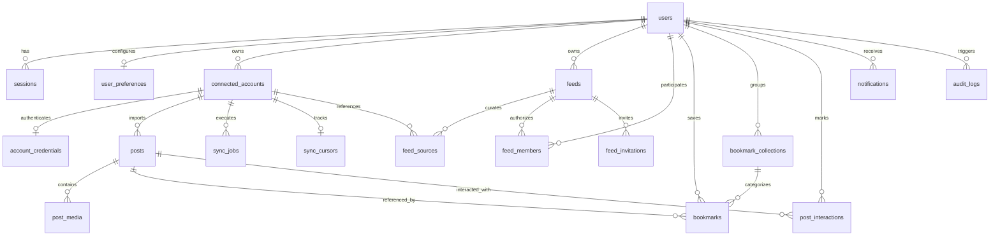

# SocialHub Database Specification & Migration Runbook

## 1. Overview

SocialHub uses **PostgreSQL 16** with **Prisma ORM**. The data model enforces strict multi-tenant isolation, idempotency across feed sync runs, encrypted credential storage, and rich relation graphs.

---

## 2. Entity Relationship Diagram



---

## 3. Core Tables and Invariants

### 3.1 `users`

- Stores authentication credentials with `passwordHash` (Argon2id).
- `deletedAt`: Soft-deletion support preserving audit trails.
- Unique index on `email`.

### 3.2 `sessions`

- Server-side session tokens with explicit `expiresAt`.
- Session tokens are securely hashed or high-entropy crypto strings.
- Cascade-deleted when user is deleted.

### 3.3 `connected_accounts`

- Links a user to an external source (YouTube channel, Subreddit, RSS feed, etc.).
- Compound unique constraint: `@@unique([userId, platform, externalAccountId])`.
- Allows following the same creator on different platforms or following the same creator by different users with full isolation.

### 3.4 `posts` and `post_media`

- Normalized posts stored in UTC (`publishedAt`).
- Compound unique constraint: `@@unique([platform, externalId])`.
- **Zero Video Binary Invariant:** Media rows store embed URLs, remote image thumbnails, dimensions, and type tags (`IMAGE`, `VIDEO`, `AUDIO`, `THUMBNAIL`). External video files are never downloaded or stored.

### 3.5 `account_credentials`

- Provider OAuth tokens, refresh tokens, and API keys are symmetrically encrypted at rest (`AES-256-GCM`).
- Plaintext credentials are never saved or returned in API responses.

### 3.6 `feeds`, `feed_sources`, `feed_members`

- Shared feeds curate source references (`feed_sources`), never user credentials.
- Membership role-based access (`OWNER`, `MODERATOR`, `MEMBER`) with state verification (`APPROVED`, `PENDING`, `REJECTED`).

---

## 4. Production-Safe Migration Workflow

> [!CAUTION]
> Production migrations must **never** run automatically on container startup. Never run `prisma db push` or `prisma migrate reset` in staging or production environments.

### 4.1 Development Migration Creation

During local development:

```bash
pnpm --filter @socialhub/database db:migrate:dev --name <migration_name>
```

### 4.2 Production Controlled Deployment Step

Before starting or swapping containers in production:

```bash
# Executed in a dedicated deployment step or via Makefile:
make migrate
# Equivalent to:
docker compose exec api pnpm prisma migrate deploy
```

### 4.3 Database Backup & Rollback Protocol

1. Prior to any migration, execute `make backup` (`infrastructure/scripts/backup.sh`).
2. If a migration fails, review PostgreSQL transaction logs. Prisma migrations execute inside individual atomic transactions.
3. If necessary, execute `make restore BACKUP_FILE=...` (`infrastructure/scripts/restore.sh`).
